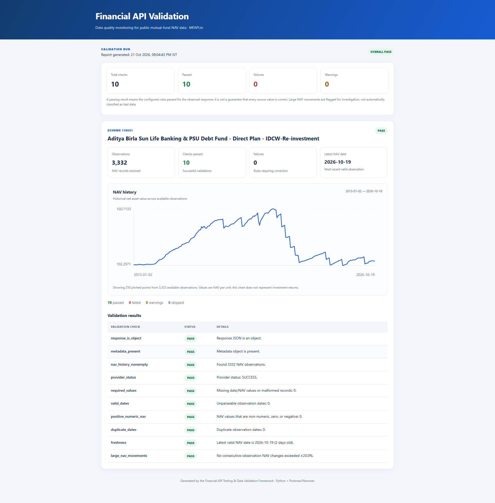
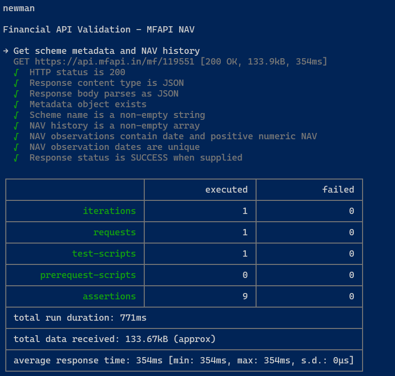
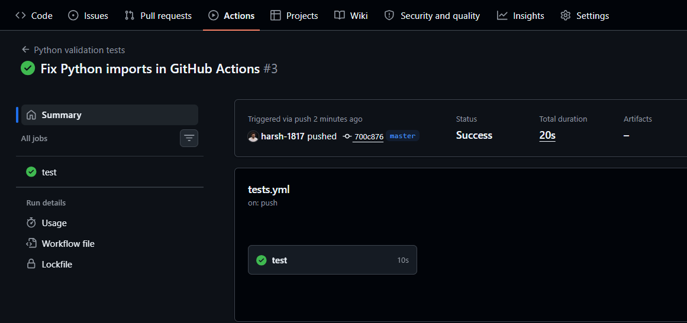

> **Note:** This is V1 and The improved v2 is here: [mf-nav-api-validation](https://github.com/harsh-1817/mf-nav-api-validation)

# Financial API Testing & Data Validation Framework


A portfolio project that tests a public mutual-fund NAV API with **Postman + Newman + Python**. It checks API availability and response structure, then runs data-quality rules on the returned NAV history and exports machine-readable and human-readable reports.

> **Data note:** The default live source is the public [MFAPI.in](https://www.mfapi.in/) mutual-fund API. Fixture data in `fixtures/` is synthetic and is used only for repeatable offline tests. This project is independent and does not use confidential employer data or private endpoints.

## Project Screenshots

### API Validation Dashboard


### Postman/Newman Test Results


### GitHub Actions — Successful CI Run


## Why this project matters

Financial data is only useful when it is timely, complete, and internally consistent. This framework demonstrates a practical validation layer between a third-party financial API and a downstream analytics pipeline.

## What it checks

- HTTP request success and JSON response structure
- Required metadata and NAV-history fields
- Missing/blank dates and NAV values
- NAV values that are non-numeric, zero, or negative
- Duplicate observation dates
- Stale latest NAV date (configurable threshold)
- Unusually large day-to-day NAV changes (configurable threshold; flagged for review, not automatically treated as proof of bad data)
- Postman assertions and Newman CLI execution
- JSON, CSV, and standalone HTML validation reports

## Architecture

```text
Public MFAPI.in endpoint
        │
        ├── Postman collection ── Newman ── assertion results
        │
        └── Python validator ── quality rules ── JSON / CSV / HTML report
```

## Repository structure

```text
fin-api-validation/
├── .github/workflows/tests.yml
├── docs/test-strategy.md
├── fixtures/sample_mfapi_response.json
├── postman/financial-api-validation.postman_collection.json
├── postman/financial-api-validation.postman_environment.json
├── reports/demo-validation-report.html
├── src/validate_nav_api.py
├── tests/test_validator.py
├── .env.example
├── .gitignore
├── package.json
├── requirements.txt
└── README.md
```

## Quick start

### 1. Requirements

- Python 3.10 or newer
- Node.js + npm (only needed for Newman/Postman CLI runs)
- Internet access for live API validation
- Postman Desktop is optional; the collection can also run through Newman

### 2. Set up Python

```bash
python -m venv .venv
```

Windows PowerShell:
```powershell
.venv\Scripts\Activate.ps1
pip install -r requirements.txt
```

macOS/Linux:
```bash
source .venv/bin/activate
pip install -r requirements.txt
```

### 3. Run the Python validation

Validate the default example scheme:

```bash
python src/validate_nav_api.py
```

Choose one or more MFAPI scheme codes:

```powershell
$env:SCHEME_CODES="119551,120503"
python src/validate_nav_api.py
```

macOS/Linux:
```bash
SCHEME_CODES="119551,120503" python src/validate_nav_api.py
```

Optional configuration:

| Variable | Default | Purpose |
|---|---:|---|
| `SCHEME_CODES` | `119551` | Comma-separated MFAPI scheme codes |
| `MAX_STALE_DAYS` | `7` | Flag latest NAV older than this many days |
| `MAX_DAILY_CHANGE_PCT` | `20` | Flag absolute consecutive NAV changes above this percentage |
| `REQUEST_TIMEOUT_SECONDS` | `20` | HTTP timeout |
| `REPORT_DIR` | `reports` | Output folder |

The script writes `reports/validation_report.json`, `reports/nav_observations.csv`, and `reports/validation_report.html`. A failed quality check appears in the report; it does not mean the upstream provider is necessarily wrong. Investigate the underlying observation before making a conclusion.

### 4. Run automated tests (offline)

```bash
pytest -q
```

These tests use the synthetic fixture and do not require network access.

### 5. Run Postman tests with Newman

Install Node dependencies:

```bash
npm install
```

Run the collection:

```bash
npm test
```

Or import the files in `postman/` into Postman Desktop and run the collection manually. The environment contains no credentials. You can change `scheme_code` to a valid scheme code from MFAPI.in if the example changes or becomes unavailable.

## Understanding the report

- **PASS** means a rule passed for the observed response.
- **FAIL** means a configured rule was violated.
- **WARN** is used for conditions worth investigating, such as a large NAV movement.
- **SKIP** means the rule could not be evaluated because required source data was missing.

A stale date may occur around weekends and market holidays. NAV movement thresholds are configurable and should be calibrated to the product and business rules before production use.

## Reproducibility and limitations

- The source is a public third-party API; availability, response fields, and scheme codes can change.
- The example scheme code is configurable and is not guaranteed to remain available indefinitely.
- The project is a validation demo, not an investment recommendation or a production-grade monitoring service.
- Synthetic fixtures are clearly labelled and are never presented as live market data.
- No API keys or private credentials are required by the default example.

### Data Quality Finding

During validation, MFAPI returned a NAV of 117.8708 for scheme 119551 on 24 June 2024, while the corresponding AMFI record showed 104.5327. The surrounding dates matched. This discrepancy demonstrates why a successful HTTP response and valid JSON structure do not guarantee financial-data accuracy.

The current framework validates the API response but does not automatically reconcile every observation against AMFI. The discrepancy was identified through manual comparison.

## Suggested resume bullet

**Built a financial API validation framework using Postman, Newman, and Python to test response schemas and validate mutual-fund NAV data for missing values, duplicates, stale observations, and abnormal movements; automated JSON, CSV, and HTML quality reporting.**

Only add a numeric test/assertion count to your resume after you have run the collection and confirmed the actual result.

## Before publishing to GitHub

1. Run the Python validator and Newman collection on your machine.
2. Review the generated report and record the actual run date and outcomes.
3. Replace the demo report only with a report you have generated yourself, or keep it clearly labelled as synthetic.
4. Add a screenshot of the HTML report or Postman test results to the README if desired.
5. Commit with a descriptive message, e.g. `Add NAV API validation pipeline and reports`.


## Author

**Harsh Trivedi**  
**MBA (Computer Management) | Data Analytics & Financial Markets**

**Certifications:** NISM Research Analyst (Series XV) · NISM Equity Derivatives (Series VIII)